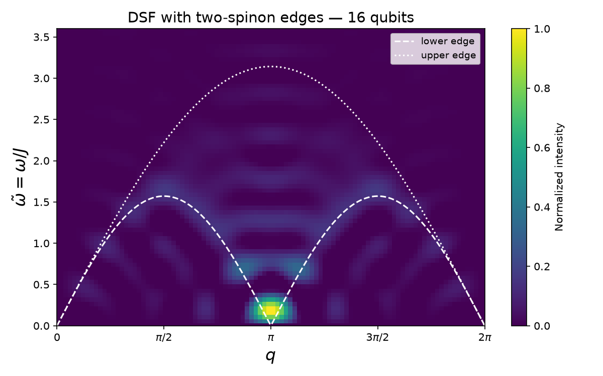

# Simulating Neutron Scattering on KCuF₃ with Quantum Circuits: a 16-Qubit Local Tutorial

A beginner-friendly, PC-sized version of IBM Quantum's neutron-scattering tutorial, which reproduces
Lee et al., *Benchmarking quantum simulation with neutron-scattering experiments* (arXiv:2603.15608).
It runs entirely on a Windows PC with Python 3.13: **no IBM account, API key or QPU time needed.**



## Why neutron scattering?

Inelastic neutron scattering (INS) provides an experimentally accessible pathway to bridge quantum
simulation with laboratory measurements. In an INS experiment, incident neutrons scatter off magnetic
ions in a material, exchanging both energy and momentum with its spins. The measured signal can be used
to compute two-point dynamical correlation functions that capture how local excitations propagate
through the system in space and time. Expressed in momentum and frequency space, these correlations
form the dynamical structure factor (DSF), which directly reveals the spectrum of collective
excitations. Because many quantum materials can be modeled by spin-1/2 Hamiltonians that are naturally
mapped onto qubit systems, digital quantum processors can be used to compute the DSF. This
correspondence provides a rigorous framework for validating quantum simulation against experimental
observables.

### Inelastic neutron scattering and the dynamical structure factor

Inelastic neutron scattering is one of the most powerful experimental probes of magnetic excitations in
quantum materials. When a beam of thermal or cold neutrons impinges on a crystal, individual neutrons
exchange both momentum and energy with the magnetic subsystem. The measured scattering intensity is
proportional to the dynamical structure factor (DSF), which encodes the full space-time correlations of
the spin degrees of freedom:

$$S^{\alpha\beta}(q,\omega) = \sum_j e^{-iqj} \int_{-\infty}^{\infty} dt\, e^{i\omega t} \langle S_0^\alpha(0)\, S_j^\beta(t) \rangle$$

**In plain words:** the equation measures how a spin at one site and time affects every other spin at
every later time, which is a full movie of disturbances rippling through the chain. It then converts
that movie into momentum and energy, which gives exactly the intensity a neutron would scatter at each
(q, ω).

## What this tutorial does

Think of a pebble in a still pond. The notebook:

1. **Prepares the ground state** of a 16-spin Heisenberg chain (the still pond), using DMRG and a
   variational circuit.
2. **Kicks the middle spin** with one `rz(π/2)` gate (the pebble).
3. **Evolves the chain in time** with 20 second-order Trotter steps (the ripples), compressing the
   first 5 steps with approximate quantum compiling (AQC).
4. **Measures ⟨σz⟩ on every qubit at every step** on Qiskit's local `StatevectorEstimator`, giving the
   retarded Green's function.
5. **Fourier-transforms** that space-time grid into S(q, ω), the heat map a neutron experiment measures.

The result shows the hallmark of KCuF₃: weight concentrated at q = π and spread between the edges of
the two-spinon continuum.

## Quick start (Windows, Python 3.13)

```powershell
py -3.13 -m venv .venv
.venv\Scripts\Activate.ps1
python -m pip install --upgrade pip
python -m pip install -r requirements.txt
python -m ipykernel install --user --name neutron-313 --display-name "Python 3.13 (neutron)"
jupyter lab
```

Open `Quantum_Code_16q_tutorial.ipynb`, select the **Python 3.13 (neutron)** kernel, and run all cells.
The run takes about 10 minutes; Steps 2 (AQC) and 3 (simulation) take most of it. See
[SETUP_16q.md](SETUP_16q.md) for troubleshooting (missing `py`, blocked scripts, kernel crashes).

## Files

| File | What it is |
|---|---|
| `Neutron_Scattering_16q_Tutorial.pdf` / `.docx` | The full tutorial: background notes, setup, annotated code, explanation of the results, glossary |
| `Quantum_Code_16q_tutorial.ipynb` | Annotated notebook, one cell per step (start here) |
| `Quantum_Code.ipynb` | Compact two-cell version of the same code |
| `requirements.txt` | Python packages |
| `SETUP_16q.md` | Setup and troubleshooting notes |
| `rgf_16q.png`, `dsf_16q.png`, `dsf_16q_bounds.png` | Example results |
| `1_Neutron_Scattering_Spin_Correlations.mp4` | Short explainer video |

## How this differs from IBM's original

| Setting | IBM large-scale run | This tutorial |
|---|---|---|
| Qubits | 50 | 16 |
| AQC compressed steps | 6 + 4 | 3 + 2 |
| MPS bond dimension | 128 | 32 |
| Trotter steps / step size | 20 / 0.6 | 20 / 0.6 |
| Execution | IBM Heron QPU with error mitigation | Local noise-free `StatevectorEstimator` |

The 50-qubit settings ran out of memory on a PC during AQC compression, and hardware execution needs an
IBM Quantum account. The physics and the code for each step are otherwise unchanged.

## Original IBM tutorials and paper

- **Paper:** [Benchmarking quantum simulation with neutron-scattering experiments](https://arxiv.org/abs/2603.15608)
  (Lee et al., UIUC, Purdue, ORNL and IBM). Simulates the KCuF₃ neutron-scattering spectrum on 50 qubits
  of IBM quantum hardware and benchmarks it against real INS data.
- **Step-by-step tutorial:** [Simulate neutron scattering in quantum materials with quantum circuits](https://quantum.cloud.ibm.com/docs/en/tutorials/simulate-neutron-scattering).
  Walks through every step of the workflow: a 10-qubit simulator example you can run locally, then a
  50-qubit run on real IBM hardware, with AQC compression on your own computer. This repository is a
  pared-down version of it.
- **Serverless workflow:** [Simulate neutron scattering with a Serverless workflow](https://quantum.cloud.ibm.com/docs/en/tutorials/simulate-neutron-scattering-with-a-serverless-workflow).
  The same experiment, with AQC compression and hardware execution packaged as a single Qiskit Serverless
  function call (30 qubits on hardware). Needs an IBM Quantum account and the AQC dynamics function
  deployed first.

## Acknowledgements

The code is adapted from IBM Quantum's step-by-step tutorial above, which reproduces the work of Lee et al.
Running on real IBM hardware requires your own IBM Quantum Platform account.
